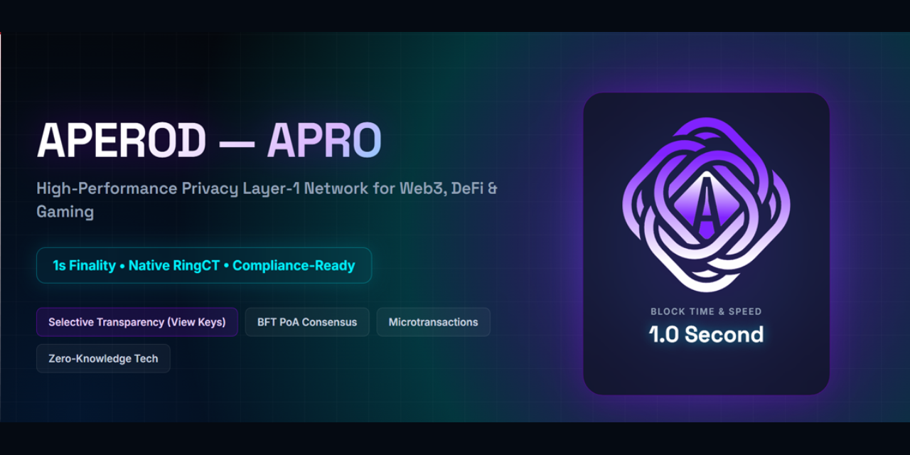

<div align="center">



# APEROD · APRO

**Privacy-preserving blockchain built for the real world.**

RingCT transaction privacy &nbsp;·&nbsp; CLSAG v5 active &nbsp;·&nbsp; Dynamic base-fee burn &nbsp;·&nbsp; Permissionless BFT-PoS

[](https://go.dev/doc/install)
[](#-license)
[](https://aperod.com)
[](https://explorer.aperod.com)
[](https://t.me/sup_apro_bot)

**[⬇ Mainnet node status](#-mainnet-node-onboarding) &nbsp;·&nbsp; [🛡 Validator onboarding status](#-mainnet-validator-onboarding) &nbsp;·&nbsp; [🌐 Explorer](https://explorer.aperod.com) &nbsp;·&nbsp; [💬 Support](https://t.me/sup_apro_bot)**

</div>

---

## LPoD — functionality, authorship, and licensing

LPoD is an Aperod protocol subsystem developed and owned by the web3
**Aperod APRO team**. It coordinates opt-in positions, validator-linked accrual,
canonical accounting and confirmed Guardian-principal refunds. **Current public
network status:** LPoD v3 is active on Aperod from canonical height **2493218**,
and its pool is funded. This live status is distinct from the repository's
fail-closed, default-disabled configuration and historical development/rehearsal
snapshots; neither is a report that the current public network is inactive.
The validator stake lock remains governed separately by the validator protocol.

**Detailed functionality guide:** [LPOD.md — protocol behavior, status, and
source scope](LPOD.md).

The original LPoD implementation was authored by the web3 **Aperod APRO team**.
Its source code and tests are licensed under the repository's
[Apache License 2.0](LICENSE), including the dedicated files identified in the
[LPoD source map](LPOD.md#16-lpod-source-map-and-authorship). The guide and
other original LPoD documentation are licensed under
[CC BY 4.0](LICENSE-DOCS). Attribution details are published in the official
[LPoD authorship section](https://aperod.com/vaults#lpod-authorship).

These licenses permit use under their terms without prior approval. They do not
claim ownership of LPoD as an abstract idea, method, algorithm, or protocol
concept, and do not restrict independently developed clean-room
implementations. Attribution requirements apply only when exercising rights in
the licensed code or documentation. Dependencies and third-party material
remain under their own terms. [LICENSE-LPOD](LICENSE-LPOD) records the
compatibility migration from the former restrictive notice.

---

## Official Links

- 🌐 **Website:** [aperod.com](https://aperod.com/)
- 🔍 **Explorer:** [explorer.aperod.com](https://explorer.aperod.com/)
- 🏛 **LPoD:** [aperod.com/vaults](https://aperod.com/vaults)
- 💰 **Wallet:** [aperod.com/wallet-extension](https://aperod.com/wallet-extension/)
- 👩‍💻 **AVM:** [aperod.com/avm](https://aperod.com/avm)
- 📊 **Live Status:** [status.aperod.com](https://status.aperod.com/)
- 🔐 **Security Log:** [explorer.aperod.com/security-reports](https://explorer.aperod.com/security-reports)
- ⚙️ **Source Code:** [github.com/aperod-network/aperod-node](https://github.com/aperod-network/aperod-node)
- 💰 **Telegram Wallet:** [t.me/aperod_bot](https://t.me/aperod_bot)
- 💬 **Support:** [t.me/sup_apro_bot](https://t.me/sup_apro_bot)
- 📩 **Email:** [aperod-network@proton.me](mailto:aperod-network@proton.me)

---

## Table of Contents

- [Why Aperod](#-why-aperod)
- [Protocol Status](#-protocol-status)
- [Mainnet Node Onboarding](#-mainnet-node-onboarding)
- [Mainnet Validator Onboarding](#-mainnet-validator-onboarding)
- [Validator Rules](#-validator-rules)
- [Tokenomics & Fee Burn](#-tokenomics--fee-burn)
- [LPoD functionality, authorship, and licensing](#lpod--functionality-authorship-and-licensing)
- [📈 Why APRO? The Deflationary Case](#-why-apro-the-deflationary-case)
- [Architecture](#-architecture)
- [Building from Source](#-building-from-source)
- [Requirements](#-requirements)
- [Security](#-security)
- [License](#-license)
- [Contributors](#-contributors)

---

## ✦ Why Aperod

| Feature | Detail |
|---------|--------|
| **Privacy** | RingCT with 16-member rings, Pedersen commitments, Bulletproof range proofs, and stealth addresses. CLSAG v5 is active from coordinated block 1,769,500 |
| **Stealth addresses** | Every payment generates a one-time address; receiver identity is never revealed |
| **Telegram wallet** | Full wallet inside Telegram — create, send, receive, and stake APRO without any app download |
| **Dynamic base-fee burn** | 100% of the protocol base fee is burned; any priority tip remains validator compensation |
| **Validator participation** | Stake-weighted participation is described in [`VALIDATORS.md`](VALIDATORS.md); a verified public mainnet onboarding release is not yet available |
| **Block rewards** | 3 APRO/block from a pre-allocated 2B APRO pool; then 1 APRO/block tail emission; no halving |
| **Game integration** | Native protocol support for in-game asset transfers and micropayments |
| **Source licensing** | Go source and tests, including LPoD, are Apache 2.0; original LPoD documentation is CC BY 4.0; dependencies retain their own terms |

---

## 🔐 Protocol Status

The current public source contains the complete **RingCT + CLSAG v5** transaction path:

- compact linkable ring signatures over public-key/commitment pairs;
- 16-member rings and canonical key images for double-spend prevention;
- Pedersen commitments, balanced pseudo-outputs, and Bulletproof range proofs;
- a persistent canonical ring-member index with bounded in-memory caching;
- replay compatibility for historical v1–v4 transactions.

CLSAG is a separate transaction version controlled by `ring_ct_clsag_activation_height`.
The value `0` keeps v5 disabled. The live network activated v5 at coordinated block
1,769,500 after the validator, wallet, storage, and API rollout completed.

Transaction-layer privacy does not hide IP addresses, timing metadata, compromised
wallets, exchange records, or other network/application-layer information.

---

## ⬇ Mainnet Node Onboarding

### Mainnet release prerequisites

Read [MAINNET.md](MAINNET.md). A verified self-service mainnet bootstrap release
is not yet published. The release must bind compatible software, the canonical
genesis, a consistent chain snapshot and the live consensus profile. Source
signatures and passing CI alone do not prove compatibility with the running chain.
Do not run a different network's installer or pipe mutable scripts into a root shell.

The current `install-validator.sh` is not a verified mainnet installer; pinning
a source commit does not make it one. Do not set a network variable or rename a
genesis file to bypass its guard. If an earlier source checkout already exists,
preserve it rather than deleting it or rerunning the clone step. A failed
preflight stops before package installation. Run shell blocks containing
`set -e` or `exit` inside a child shell (`(...)`) so a failed check cannot close
the SSH session.

The public `v0.1.1-p2p` binary is Linux amd64 only, and its release notes state
that production compatibility has not been claimed or deployed. No
OS/architecture is currently verified for self-service mainnet onboarding.

Installation and automatic mainnet connection are not yet a verified public
procedure. For an existing installation, this read-only check validates its
configuration without starting a node or signing blocks:

```bash
(
  set -euo pipefail
  test -x /usr/local/bin/aperod-node
  test -f /etc/aperod/node.yaml
  sudo /usr/local/bin/aperod-node --config /etc/aperod/node.yaml --validate-config
)
```

### Verify the node is running

```bash
systemctl status aperod-node          # service status
journalctl -u aperod-node -f          # live logs
curl -s http://localhost:8545/api/v1/status | jq .   # chain tip
```

### Watchdog — configurable probe interval

The installer sets up a **watchdog timer** (`aperod-node-watchdog.timer`) that probes the node API every 60 seconds and automatically restarts the node if it stops responding.

To change the interval **without editing unit files or redeploying**:

```bash
# 1. Open the watchdog config (created automatically by the installer)
sudo nano /etc/aperod/watchdog.env

# 2. Set the desired interval in seconds (minimum: 5)
WATCHDOG_INTERVAL_SECS=15   # faster detection for HA setups
# WATCHDOG_INTERVAL_SECS=60  # default — suitable for most nodes
# WATCHDOG_INTERVAL_SECS=120  # reduced noise for low-power validators

# 3. Apply the change (writes a systemd drop-in and restarts the timer)
sudo aperod-watchdog-set-interval
```

Verify the new interval is active:

```bash
systemctl list-timers aperod-node-watchdog.timer
```

The `60 s` default is preserved for all existing deployments — only nodes that explicitly set `WATCHDOG_INTERVAL_SECS` in `watchdog.env` and run `aperod-watchdog-set-interval` will use a different value.

---

## 🛡 Mainnet validator onboarding

**A verified self-service procedure for joining the existing mainnet is not
available yet.** This repository does not currently provide a verified
clean-server installer, canonical mainnet bootstrap, on-chain stake-locking
flow, or proof of active-set inclusion.

The public `POST /api/validators/apply` endpoint exists, but it only creates an
off-chain application record in the API database. It does not register a
validator on-chain, lock stake, whitelist a P2P peer, or activate block signing.
The former instructions to transfer APRO to a wallet and expect automatic
activation did not establish those operations and have been removed. Do not
send APRO or expose a consensus key based on them.

Read [MAINNET.md](MAINNET.md) for the prerequisites and read-only checks. It is
not an installer. A working operator guide requires an exact reviewed release
and an isolated clean-server rehearsal that proves the node joins the existing
chain without creating another genesis, then completes registration, stake
locking, and active-set verification.

---

## 📋 Validator Rules

See [**VALIDATORS.md**](VALIDATORS.md) for the complete rule set and protocol specification.

The values in `VALIDATORS.md` are a protocol reference, not proof that the
corresponding registration, stake-locking, slashing, or active-set behavior is
available on the current public mainnet. Verify those behaviors against a
reviewed release before relying on the values or transferring funds.

---

## 🔥 Tokenomics & Fee Burn

> **Every protocol base fee is permanently burned. 100 %. Always.**

Aperod starts with a fixed genesis allocation and uses a deflationary fee model:

> **Historical development/rehearsal snapshot — not current Aperod public-network
> status:** **Guardian Fund preparation is not active.** The documented nominal
> allocations already total 10B APRO, and no allocation debit for the proposed
> 1B APRO protocol lock has been approved. Node startup therefore rejects every
> nonzero Guardian activation setting. The node API may report
> `canonical_detected` when it sees the canonical transaction, but that is not
> BFT finality and must not reduce circulating supply; finality wiring is still
> incomplete. This preparation does not assert that the actual production
> genesis is empty, nor that global UTXO supply has been proven.

### Coordinated LPoD protocol — repository/config default-disabled

`consensus.lpod_migration_file` is an opt-in **coordinated consensus fork**, not
an administrative mint switch. The repository/config defaults remain
fail-closed: no production reconciliation witness or approved activation is
included in the repository's default configuration. This describes the
repository and historical development/rehearsal snapshots, not the active
Aperod public network. The legacy Guardian activation must remain disabled.

Activation on a new network requires the complete historical coinbase
commitment openings and a strictly greater-than-two-thirds quorum of the
**trusted genesis validator set** attesting the genesis, activation height,
unambiguous full-body root, issued total, validator reserve remaining, and
reconciliation witness root. Historical transaction hashes alone do not commit
unambiguously to legacy bodies. Auditors must independently approve those
bodies and budget; a self-hashed witness is not an audit. Missing, pruned,
altered, or unattested history fails closed. The attested validator budget must
equal the existing durable pool balance: it is never reset or silently reduced.

Available funding is computed as 10B minus historical issuance, the attested
**remaining** validator reserve, and an additional protected 1B development
reservation. The once-only 1B LPoD debit/credit, checkpoint, block, validator
draw, payout outputs, consumed position key images, and AVM writes commit in one
batch. Historical validator rewards are not charged twice. The full development
reservation is conservative; this fork grants no authority to spend it.

* Version 9 positions use the existing MLSAG-v4 direct ownership/opening proof
  with a linked source key image, plus a separate beneficiary spend-key proof.
  Signatures bind genesis, source/position, vault, beneficiary, action and nonce.
  Deposits consume real unvested UTXOs; web sessions never create principal.
* Positions accrue individually with persistent integer APR remainders, including
  vaults whose validator did not propose. Canonical timestamp deltas are capped
  at 15 seconds per block. Newly deposited principal earns from the following
  block; inactive validators stop new accrual but existing arrears remain due.
* Signed full withdrawals stop subsequent accrual. After the withdrawal is
  canonically confirmed, Guardian principal is refunded exactly once without
  the former 144,000-block Guardian wait. This does not shorten or bypass the
  separate validator stake lock. Paid, fully closed positions release the
  4,096-live-position capacity; spent source key images still prevent reopening
  an old deposit.
* Version 10 pays the exact leader, Angels and mature-principal plan as real
  wallet-scannable outputs; recipients are aggregated and sorted. Output
  ephemeral scalars are deterministic and parent/checkpoint-bound, not secret;
  protocol beneficiaries and amounts are public. Ordinary CLSAG spending works.
  Version 8 commits the complete resulting position/accounting checkpoint.
* Nine-tier leader shares and APRs use canonical stake. Scarce funds are allocated
  in canonical vault order, proportionally within each vault; unpaid amounts
  remain position-specific arrears and are retried, never counted as paid.
  Subsequent self-stake growth above 100M uses the top tier, while new Guardian
  deposits cannot push a vault above 100M.
* The existing 3-APRO pool reward, last partial draw, and 1-APRO tail continue.
  Tail issuance is recorded separately; after exhaustion the conservation
  equation is the initial 10B **plus explicitly recorded tail issuance**.
* Restart reads hash-keyed committed positions and carries, not a default pool.
  Ancestor rollback restores native indices and reserve selection. Rewind first
  to the common parent, then commit alternate blocks normally. Rewinding earlier
  than the attested funding parent requires additional historical budget evidence
  and fails closed; it does not guess the old reserve.

**Current public network:** LPoD v3 is active on Aperod from canonical height
**2493218**, and the pool is funded. `GET /api/v1/lpod-pool` reports active
monetary state only when the exact current canonical checkpoint hash has live
finality evidence. Restart does not invent finality from height alone. Native
position capability is reported separately from activation; pending/disabled
balances remain null. For a new network, source attestations, protocol review,
coordinated node upgrades and deployment authorization remain prerequisites
before activation. Repository/config defaults stay fail-closed; activation is a
protocol/governance event, and availability under Apache License 2.0 does not
itself activate LPoD on any chain.

```
Genesis supply:       10,000,000,000 APRO  (10B)
Circulating (launch):  9,000,000,000 APRO  (9B — 90% Public / IDO / Liquidity)
Dev Fund locked:       1,000,000,000 APRO  (10%, 12-month cliff + 48-month linear vest)
Block time:            3 seconds
Block throughput:      28,800 blocks / day
Pool reward:           3 APRO per block from a pre-allocated 2B APRO pool
Pool-phase issuance:   0 APRO (existing genesis supply is redistributed)
Tail emission:         1 APRO per block after pool exhaustion (~63 years)
Halving:               none
Transaction fee:       dynamic EIP-1559 · base 200 nAPRO/byte · adjusts ±12.5%/block
                       P2P transfer ~2 KB ≈ 0.004 APRO
                       Game / NFT tx ~4 KB ≈ 0.008 APRO
Base-fee destination:  🔥 complete base fee — burned 100%
Priority tip:          optional proposer compensation
```

The protocol reference describes the pool reward and later tail emission;
it does not prove a specific validator is active or that any particular
operator will receive a payout. Transaction fees never reach validator wallets.
The burn is enforced at the consensus layer — not a governance parameter, not toggleable.

See [**BURN\_POLICY.md**](BURN_POLICY.md) for full tokenomics and deflationary mechanics.

---

## 📈 Why APRO? The Deflationary Case

### EIP-1559 = Automatic Token Buyback

> *"The EIP-1559 mechanism in Aperod works like an automatic buyback — for every type of transaction. A simple wallet transfer burns APRO. An NFT trade burns APRO. A DeFi swap burns APRO. A game action burns APRO. The more the network is used for anything, the fewer coins remain in circulation. By year 5, even modest everyday usage alone shrinks the supply by ~10%, creating organic scarcity that pushes APRO price up — without any manipulation."*

Every on-chain transaction type permanently destroys the base fee:

| Transaction type | Approx. fee burned per tx |
|-----------------|--------------------------|
| P2P transfer (~2 KB) | ~0.004 APRO |
| Token swap / DeFi (~3 KB) | ~0.006 APRO |
| NFT trade (~4 KB) | ~0.008 APRO |
| Game action (~4 KB) | ~0.008 APRO |

The burn is consensus-enforced — not a governance parameter, not toggleable.  
**Starting at launch: −9.87 % supply reduction by 2031** from ordinary network usage alone.

---

### 3 Price Growth Scenarios

*Starting price $0.001 · Supply 10 B APRO · 5-year horizon (2026–2031)*

| Scenario | Driver | Price target | Change |
|----------|--------|-------------|--------|
| **A · Conservative** — deflation only, demand stable | Supply shrinks 9.87 %; market cap stays at $10 M. Pure math, no extra demand needed. | $0.001 → **$0.00111** | **+10.9 %** |
| **B · Realistic Web3** — deflation + organic gaming demand | Real network usage (transfers, DeFi, NFTs) + 20–30 games. Supply −10 % meets demand ×10–15 (normal for any active L1). Market cap grows to $100 M. | $0.001 → **$0.011** | **+1,100 %** |
| **C · Maximum** — Global GameFi hub, year 25 | 3–4 B tokens burned over 25 years. Aperod reaches top-tier L1 network status. Market cap $1–2 B. | $0.001 → **$0.15 – $0.30** | **+15,000 % – +30,000 %** |

---

### Validator onboarding status

No verified procedure currently establishes that a new operator can register,
lock eligible stake, enter the Mainnet active set, and produce an accepted
block. Do not rely on projected validator income or transfer funds based on
the protocol reference alone. See [Mainnet onboarding](MAINNET.md) for the
checks still required before public validator instructions can be published.

---

## 🏗 Architecture

```
aperod-node/
├── cmd/
│   ├── node/        — aperod-node binary  (full node + RPC)
│   └── cli/         — aperod binary       (wallet CLI + chain inspection)
├── consensus/       — BFT-PoS engine: stake-selected active set, rotating proposer, ≥2/3 finality
├── core/            — Block, Transaction, UTXO, Mempool, Chain, Merkle root
├── crypto/          — Ed25519, SHA3-256/512, RingCT, CLSAG, Pedersen commitments, Bulletproofs
├── p2p/             — Peer discovery, block/tx propagation, DNS bootnode resolution
├── store/           — LevelDB with typed key prefixes; archive + light pruning modes
├── wallet/          — HD wallet (BIP-39 + SLIP-0010 + Ed25519), stealth address builder
├── config/          — node.yaml schema, genesis configuration
└── deploy/          — install scripts, Dockerfile, monitoring stack
```

**Cryptographic primitives:**

| Primitive | Library / Standard |
|-----------|-------------------|
| Elliptic curve | Ed25519 — `filippo.io/edwards25519` |
| Hash function | SHA3-256 / SHA3-512 — `golang.org/x/crypto` |
| Ring signatures | CLSAG v5, ring size 16 (active since block 1,769,500); historical MLSAG formats remain replay-compatible |
| Commitments | Pedersen over Ed25519 |
| Range proofs | Bulletproofs (IPA variant) |
| HD key derivation | BIP-39 mnemonics + SLIP-0010 + Ed25519 |
| Address format | Base58Check — dual-key (spend key + view key) |

---

## 🔨 Building from Source

### Prerequisites

- **Go 1.26.11** (required by `go.mod`) — [install](https://go.dev/doc/install)
- `make`, `git`

### Clone & build

```bash
git clone https://github.com/aperod-network/aperod-node.git
cd aperod-node
make build
```

Outputs:

| Binary | Path | Description |
|--------|------|-------------|
| `aperod-node` | `build/aperod-node` | Full node process |
| `aperod` | `build/aperod` | CLI wallet & chain inspector |

### Common commands

```bash
# Validate an existing mainnet profile without starting a node
./build/aperod-node --config /etc/aperod/node.yaml --validate-config

# Generate a new wallet (mnemonic + addresses)
./build/aperod wallet create

# Check wallet balance
./build/aperod wallet balance <address>

# Generate a validator consensus key
./build/aperod validator keygen --out ./keys/validator.key

# Inspect a block
./build/aperod chain block <height>
```

### Upgrading a running node (production)

**Use `upgrade-node.sh` — the canonical single command for safe upgrades.**

```bash
sudo bash /opt/aperod/blockchain/deploy/upgrade-node.sh
```

`upgrade-node.sh` is the recommended upgrade path. Before restarting the service it
guarantees that the memory-protection systemd drop-ins are present and active:

| Drop-in | Value | Purpose |
|---------|-------|---------|
| `timeout.conf` | `TimeoutStopSec=900` | Prevents SIGKILL mid-snapshot (Aug 2026 outage root cause) |
| `gomemlimit.conf` | `GOMEMLIMIT=5 GiB` | Prevents OOM-kill and LevelDB corruption under memory pressure |

The script then delegates to `update-node.sh`, which stops the service, pulls the
latest source, rebuilds the binary, installs it to `/usr/local/bin/aperod-node`, restarts
the service, and waits for the API to respond. Telegram alerts are sent on build or
startup failure.

The script is **idempotent** — safe to re-run at any time.

> **Why not `make build` + `cp` directly?**
> Copying over a running binary fails with `Text file busy`. Building to any path other
> than `/usr/local/bin/aperod-node` is silently ignored by the service. A manual sequence
> also risks forgetting to apply the memory-protection drop-ins that prevent OOM-kill and
> snapshot corruption. `upgrade-node.sh` prevents all of these mistakes in a single command.

### Run tests

```bash
make test                    # full test suite with race detector
make test-cover              # with HTML coverage report
```

---

## ⚙ Requirements

| Component | Minimum | Recommended |
|-----------|---------|-------------|
| CPU | 2 cores | 4 cores |
| RAM | 4 GB | 8 GB |
| Disk | 50 GB SSD | 200 GB NVMe |
| Network | 10 Mbps | 100 Mbps |
| OS | Ubuntu 22.04 | Ubuntu 24.04 LTS |
| Open ports | 30303 / tcp + udp | — |
| RPC | 8545 / tcp (localhost only) | — |

---

## 🔍 Diagnosing CPU / Memory Spikes (pprof)

The node ships a built-in Go [pprof](https://pkg.go.dev/net/http/pprof) endpoint that lets you capture CPU flame graphs, heap snapshots, and goroutine dumps in seconds — no rebuild required.

### Enable

In `node.yaml` (or the production overlay), set:

```yaml
pprof:
  enabled: true
  listen_addr: "127.0.0.1:8546"   # loopback only — never expose publicly
```

Restart the node.  You will see:

```
{"level":"INFO","msg":"pprof endpoint started","addr":"127.0.0.1:8546","hint":"go tool pprof http://127.0.0.1:8546/debug/pprof/profile?seconds=30"}
```

### Capture profiles (from the server)

```bash
# 30-second CPU flame graph
go tool pprof http://127.0.0.1:8546/debug/pprof/profile?seconds=30

# Heap snapshot
go tool pprof http://127.0.0.1:8546/debug/pprof/heap

# Goroutine dump (text, great for deadlock diagnosis)
curl -s "http://127.0.0.1:8546/debug/pprof/goroutine?debug=2"

# Allocs, mutex, block profiles
go tool pprof http://127.0.0.1:8546/debug/pprof/allocs
go tool pprof http://127.0.0.1:8546/debug/pprof/mutex
go tool pprof http://127.0.0.1:8546/debug/pprof/block
```

### Via SSH tunnel (remote server)

```bash
# On your laptop — forward remote 8546 to local 8546
ssh -L 8546:127.0.0.1:8546 user@your-server

# Then locally
go tool pprof http://127.0.0.1:8546/debug/pprof/profile?seconds=30
```

### Security notes

- `listen_addr` **must** be `127.0.0.1:…` (loopback).  Never bind to `0.0.0.0`.
- Disable (`enabled: false`) when not actively diagnosing — pprof exposes internal runtime metrics.
- The endpoint runs on a **separate port** (default 8546) and is completely isolated from the public API (port 8545).

---

## 🔒 Security

- **Consensus key ≠ wallet key** — the key that signs blocks has no ability to move funds
- **RPC (port 8545) binds to `127.0.0.1` by default** — never expose externally without a firewall
- **pprof (port 8546) disabled by default** — enable only for active diagnosis, loopback only
- **Consensus key stored with `chmod 600`** — readable only by the `aperod` system user
- **Double-sign detection** — conflicting signatures are detected; the current source does not implement the documented 10% stake debit, so slashing must not be treated as enforced
- **View key sharing** — share your view key for read-only auditing without granting spending ability

To report a vulnerability, see [SECURITY.md](SECURITY.md).

---

## 📄 License

Copyright 2024 [aperod-network](https://github.com/aperod-network)

Source code and tests are licensed under the **Apache License, Version 2.0**;
see [LICENSE](LICENSE). This includes the original LPoD implementation authored
by the web3 Aperod APRO team.

Original LPoD documentation, including [LPOD.md](LPOD.md), is licensed under
**Creative Commons Attribution 4.0 International**; see
[LICENSE-DOCS](LICENSE-DOCS).

Attribution and the superseded LPoD notice are explained in [NOTICE](NOTICE)
and [LICENSE-LPOD](LICENSE-LPOD). Dependencies and third-party material remain
under their own terms.

---

## 👥 Contributors

<table>
  <tr>
    <td align="center">
      <a href="https://github.com/aperod-network">
        <br />
        <b>aperod-network</b>
      </a>
    </td>
  </tr>
</table>

---

<div align="center">
  <sub>
    <a href="https://aperod.com/">Website</a> &nbsp;·&nbsp;
    <a href="https://explorer.aperod.com/">Explorer</a> &nbsp;·&nbsp;
    <a href="https://aperod.com/vaults">LPoD</a> &nbsp;·&nbsp;
    <a href="https://aperod.com/wallet-extension/">Wallet</a> &nbsp;·&nbsp;
    <a href="https://aperod.com/avm">AVM</a> &nbsp;·&nbsp;
    <a href="https://status.aperod.com/">Live Status</a> &nbsp;·&nbsp;
    <a href="https://explorer.aperod.com/security-reports">Security Log</a> &nbsp;·&nbsp;
    <a href="https://github.com/aperod-network/aperod-node">Source Code</a> &nbsp;·&nbsp;
    <a href="https://t.me/aperod_bot">Telegram Wallet</a> &nbsp;·&nbsp;
    <a href="https://t.me/sup_apro_bot">Support</a> &nbsp;·&nbsp;
    <a href="mailto:aperod-network@proton.me">Email</a>
  </sub>
</div>
